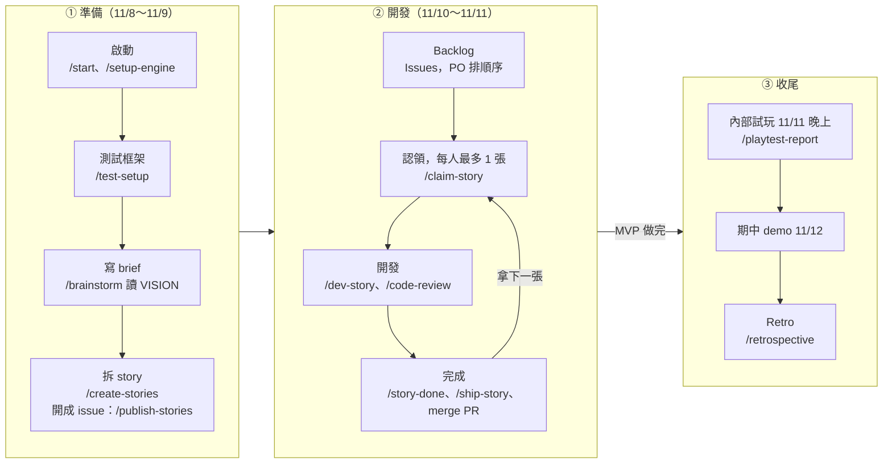
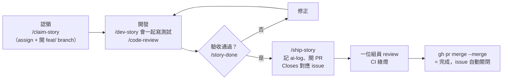

# 團隊流程（group-agile）

來源：[Issue #1](https://github.com/ntust-swe-project/group-agile/issues/1)。這份是 repo 裡唯一的流程說明，
每個 Claude Code session 都會透過 `CLAUDE.md` 自動載入。**與 CCGS 的規則衝突時，以本文件為準。**

## 角色與節奏

| 角色 | 誰 | 負責 |
| --- | --- | --- |
| A：PO | yichieh-chen | backlog 內容與順序、驗收問題、`INV` 判定、砍範圍、demo |
| B：流程負責人 | anitaaa17 | 每日同步、追卡住的人、WIP、merge 衝突與 CI、試玩與 Retro |
| C：AI 紀錄負責人 | eden2289 | ai-log 規範、每日查漏記、`API`/`INV` 分類、統計 |

- 三人都寫 code。每晚 22:00 在群組同步三行（做了什麼／接下來／卡在哪）＋「ai-log 今天記了 N 筆」。
- 11/10～11/11 開發，11/11 晚上內部試玩，11/12 期中 demo，之後 Retro。

## 整體流程

## 一張 story 怎麼做完

## Backlog 怎麼表示（GitHub Issues）

| 狀態 | 在 GitHub 上的樣子 |
| --- | --- |
| 提案（還不是 story） | open、label `proposal`，標題 `[Proposal] …` |
| 可以拿 | open、label `story`、沒有 assignee |
| 進行中 | open、assignee 是你（每人最多 1 張） |
| 待 review | 有 `feat/<編號>-…` 的 open PR |
| 卡住 | label `blocked` |
| 完成 | closed（PR merge 時由 `Closes #N` 自動關） |

- **順序**：標題開頭的 `S01`、`S02`…，數字小的先做。PO 要調順序就改標題編號。
- issue 內文第一行 `Story: <story 檔路徑>` 指向 CCGS 的 story 檔；story 檔也寫回 `> **Issue**: #N`。
- story 檔要先 merge 進 main，組員從 main 開 branch 才讀得到。PO 拆 story 時一樣在 branch 上做（例如 `docs/1-stories`），`/create-stories` → `/publish-stories` → 開 PR。

## 新需求怎麼提（提案 → story）

有新點子（功能、畫面、試玩回饋）時，**先開提案，不要直接開 story**；story 由 PO 開。

1. **開提案**：New issue 選 **Proposal** 範本（會自動帶 `[Proposal]` 標題與 `proposal` label）。一張只寫一件事：哪裡不夠、希望變成什麼、對到 VISION 哪一節（對不到就寫「VISION 沒有」）、是不是 AI 提的（AI 提的要記 ai-log，角色 C 才統計得到 `INV`）。
2. **討論**留在該提案 issue 底下，不要留在置頂的入口 issue。
3. **PO 判定**（有空時看 `is:open label:proposal`）：

   | 判定 | 做法 |
   | --- | --- |
   | 收 | 在 `docs/<提案 issue 編號>-…` branch 跑 `/create-stories` → `/publish-stories` 開成 story，提案留言 `→ #<story issue>` 後關閉 |
   | 不收 | 留言寫原因（例如 VISION §6 範圍外、時程不夠）後關閉 |
   | 之後再說 | 留言說明原因，保持 open |

- 提案沒有 `story` label，不會出現在看板，也不能 `/claim-story`。
- 不收的提案只關閉、不刪除：它是範圍判定的紀錄。
- 置頂的「新需求入口」issue 只放連結；規則以本節為準。

## 所有人都要遵守

1. 拿排序最上面那張；要跳過先問 PO。
2. branch：`feat/<issue 編號>-<英文小寫名稱>`（修 bug 用 `fix/`，文件與設定用 `docs/`、`chore/`，一樣要帶 issue 編號）。
3. commit 依 project-common 的 `COMMIT_CONVENTION.md`（範本見 `.gitmessage`）：
   `<type>(<scope>): <subject>`，type 只能是 `feat fix docs refactor test chore build`，第一行 72 字元內、英文祈使句、句尾不加句號。
   AI 協助的 commit 在 footer 加 `Co-Authored-By: <模型> <noreply@anthropic.com>`（其他工具用 `Assisted-by: <工具>:<模型>`）。
   **CCGS `/story-done` 建議的 `feat: 標題 (TR-ID)` 格式不適用，以這條為準。**
4. PR 開到 `main`，用 PR 範本，內文寫 `Closes #<編號>`；1 人 review、CI `Run GdUnit4 Tests` 與 `process-check` 都綠燈才 merge；用 merge commit，不 squash。
5. 用到 AI 就記 ai-log（`docs/ai-log/AI_LOGGING_RULES.md`）；AI 給的 Godot API 要對照 4.7 文件。
6. **完成的定義**：Godot 4.7.2 跑得起來、通過驗收（`/story-done`）、邏輯類有測試、畫面類有截圖、PR 有人 review、ai-log 已記。

## 指令

| 指令 | 誰用 | 做什麼 |
| --- | --- | --- |
| `/board` | 所有人 | 看板：你手上的卡、可以拿的卡、誰在做什麼、待 review 的 PR、下一步 |
| `/claim-story [編號]` | 所有人 | 檢查 WIP、assign 給你、從最新 main 開 `feat/<編號>-<名稱>` |
| `/dev-story`、`/code-review`、`/story-done` | 所有人 | CCGS 原生：實作＋測試、review、驗收 |
| `/ship-story` | 所有人 | 完成的定義檢查、記 ai-log、push、用範本開 PR |
| `/publish-stories <epic>` | PO | 把 `/create-stories` 產生的 story 檔開成 issue 並排序 |
| `/sprint-status`、`/scope-check`、`/playtest-report`、`/retrospective` | B、PO | CCGS 原生 |

腳本本體在 `.claude/team/`（`bash .claude/team/team.sh board` 也能直接在 Git Bash 跑）。需要 Python 3 與已登入的 GitHub CLI（`gh auth login`）。

## 守門：什麼會被擋下

`.claude/settings.json` 的 hook 會在 Claude 執行前檢查，違反時直接擋下並說明原因；無法確認的（例如沒裝 `gh`）會改成先問使用者。

| 動作 | 擋下的情況 |
| --- | --- |
| 在 `main` 上改 repo 檔案 | 一律擋（gitignore 的檔案除外），請先 `/claim-story` |
| 開新 branch | 名稱不符規則；`feat/`、`fix/` 的 issue 不是你認領的；你手上已有其他進行中的卡 |
| `git commit` | 在 `main` 上；branch 名稱不符；message 不符 COMMIT_CONVENTION；缺 AI footer |
| `git push` | 推到 `main`、`--all`、`--mirror` |
| `gh pr create` | 沒有 `Closes #N`；ai-log 勾選框沒勾；完成的定義檢查（`team.sh preflight`）有 FAIL |
| `gh pr merge` | 沒有 `--merge`、用 squash/rebase/`--admin`/`--auto`；沒人 approve；CI 不是綠燈 |
| 改 `.claude/settings.json`、`.claude/hooks/`、`.claude/team/`、`.github/workflows/` | 先問使用者（需 PO 同意，並告知角色 C）；PR 需作者以外的組員 approve |

GitHub Actions 的 `process-check` 會對每個 PR 再檢查一次（branch、`Closes #N`、範本勾選、commit 格式、AI footer 與 ai-log 是否對得上、是否改到別人的 log）。

**權限不能偷偷放寬**：`process-check` 會跑 `.claude/team/test_permissions.py`，以下任一情況 CI 就會失敗：
- `.claude/settings.json` 的 allow 超出 `.claude/team/permissions-baseline.json`、拿掉 deny、改 `defaultMode`、hook 跑 repo 外的指令
- `team.py` 執行 allowlist 以外的動作（例如 push、merge、改別人的 assignee、PATCH/PUT GitHub）

要放寬就得改 baseline 或測試，這些都屬於守門檔案（`.claude/settings.json`、`.claude/hooks/`、`.claude/team/`、`.github/workflows/`）。改到它們的 PR 需要**作者以外的組員 approve**，`process-check` 才會變綠燈。私有 repo 沒有分支保護，紅燈不會自動擋 merge，**紅燈就不要 merge**。

## 給 Claude 的規則（每個 session）

1. session 開始時會收到「團隊看板」。**第一則回覆先用 2～3 行告訴使用者**：手上的卡、下一張可以拿的卡、下一步。看板讀取失敗就說明原因（通常是 `gh` 沒裝或沒登入）。
2. 使用者要開始寫 code，但不在自己認領的 `feat/` branch 上：先引導 `/claim-story`，不要直接開工。
3. 開 PR 一律走 `/ship-story`；merge 用 `gh pr merge <編號> --merge`。
4. 被【團隊流程】hook 擋下時：把原因用一兩句話告訴使用者，並提出正確做法。**不要換個寫法繞過**（例如改用 PowerShell、包進 script、`git -c`、改 hook 或 settings、用網頁操作代替），也不要自行修改 `.claude/team/`。
5. 問題在流程本身（例如規則擋錯了）：請使用者告訴 PO，由 PO 決定是否修改本文件與守門腳本。
